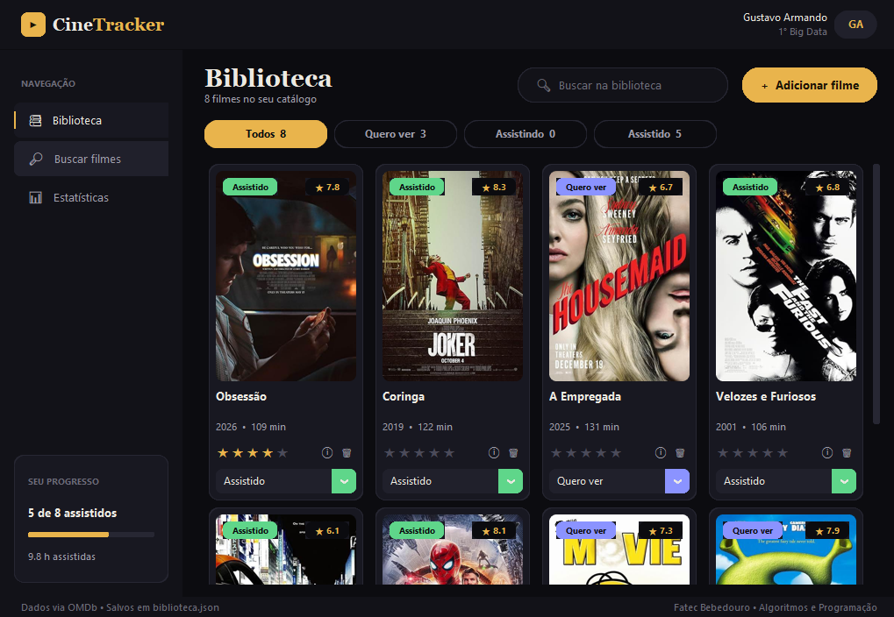
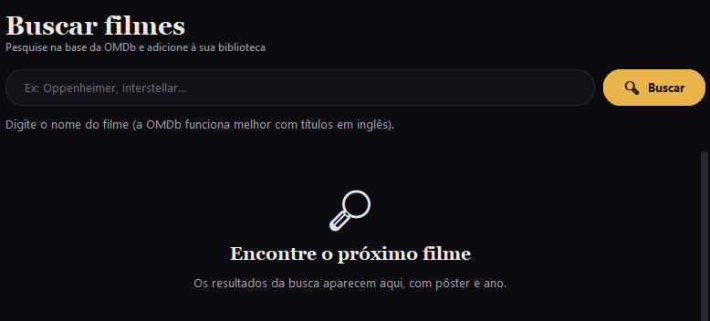
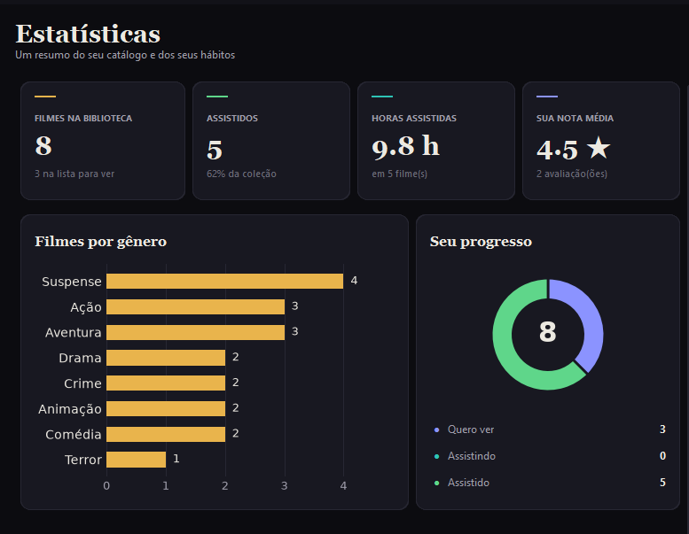
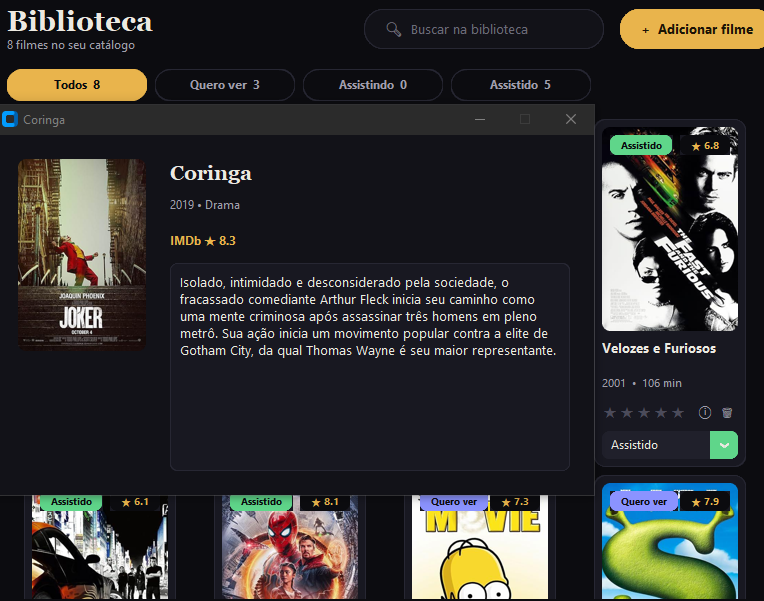

# CineTracker 🎬

Aplicação desktop desenvolvida em Python para organizar uma biblioteca pessoal de filmes, acompanhar o que você pretende assistir e registrar sua experiência cinematográfica.

O projeto foi desenvolvido como trabalho final da disciplina de Algoritmos e Programação da Fatec Bebedouro.

## 🎯 Objetivo

O CineTracker surgiu da ideia de criar uma ferramenta simples para organizar o consumo de filmes em um só lugar.

Em vez de depender de anotações ou listas espalhadas, o usuário pode pesquisar títulos, adicioná-los à própria biblioteca, acompanhar seu progresso e visualizar estatísticas sobre seus hábitos cinematográficos.

## ✨ Funcionalidades

- **Busca de filmes:** pesquisa de títulos por meio da API OMDb.
- **Biblioteca pessoal:** adição e organização dos filmes encontrados.
- **Acompanhamento:** classificação dos filmes em "Quero ver", "Assistindo" e "Assistido".
- **Avaliações pessoais:** registro de notas para os filmes.
- **Pôsteres:** exibição e armazenamento local das imagens dos filmes.
- **Estatísticas:** visualização da quantidade de filmes, progresso, horas assistidas, média das avaliações e distribuição por gênero.
- **Persistência de dados:** armazenamento da biblioteca em arquivo JSON, com cópia de segurança.
- **Tradução complementar:** integração opcional com a API TMDb para obter títulos e sinopses em português.

## 🛠️ Tecnologias utilizadas

- **Python 3.9+:** linguagem principal.
- **CustomTkinter:** construção da interface gráfica.
- **Requests:** comunicação com APIs externas.
- **OMDb API:** obtenção dos dados dos filmes.
- **TMDb API (opcional):** complemento de títulos e sinopses em português.
- **Pillow:** processamento e exibição de imagens.
- **Matplotlib:** criação dos gráficos estatísticos.
- **JSON:** armazenamento local da biblioteca e configurações.
- **Threading e Queue:** execução de tarefas em segundo plano para evitar travamentos durante as consultas.

## ⚙️ Instalação

### Requisitos

- Python 3.9 ou superior.
- Conexão com a internet.
- Uma chave de API da OMDb (obrigatória para pesquisar filmes).

### Baixar o projeto

Clone o repositório:

```bash
git clone https://github.com/kurxgane/CineTracker.git
cd CineTracker
```

### Instalar as dependências

É recomendado criar um ambiente virtual:

```bash
python -m venv .venv
```

No Windows:

```bash
.venv\Scripts\activate
```

No Linux ou macOS:

```bash
source .venv/bin/activate
```

Instale as dependências externas:

```bash
python -m pip install -r requirements.txt
```

O arquivo `requirements.txt` reúne as bibliotecas externas do projeto. Elas são instaladas pelo `pip`. Módulos como `json`, `os`, `threading` e `queue` fazem parte da biblioteca padrão do Python. O Tkinter normalmente acompanha o Python; em algumas distribuições Linux, pode ser necessário instalar `python3-tk`.

## 🔑 Configuração das APIs

A OMDb é a fonte principal dos dados e precisa ser configurada para que a pesquisa funcione. A TMDb é um complemento opcional para títulos e sinopses em português.

### OMDb (obrigatória)

1. Acesse https://www.omdbapi.com/apikey.aspx.
2. Solicite uma chave gratuita e ative-a pelo link enviado ao seu e-mail.
3. Copie `config.example.json` e renomeie a cópia para `config.json`.
4. Preencha `omdb_api_key` com sua chave.

### TMDb (opcional)

1. Crie uma conta em https://www.themoviedb.org.
2. Acesse Configurações → API e copie o Token de Acesso de Leitura da API.
3. Preencha `tmdb_read_access_token` no `config.json`.

Os campos `nome_aluno` e `curso_aluno` são opcionais e, quando preenchidos, aparecem no cabeçalho.

Exemplo de `config.json`:

```json
{
  "omdb_api_key": "SUA_CHAVE_OMDB",
  "tmdb_read_access_token": "SEU_TOKEN_TMDB",
  "nome_aluno": "",
  "curso_aluno": ""
}
```

Também é possível usar as variáveis de ambiente `OMDB_API_KEY` e `TMDB_READ_ACCESS_TOKEN`. Quando definidas, elas têm prioridade sobre os valores do arquivo.

**Segurança:** `config.json` contém credenciais pessoais e é ignorado pelo Git. Nunca publique esse arquivo nem inclua chaves ou tokens no código. O aplicativo abre mesmo sem a chave da OMDb, mas a pesquisa só funciona depois da configuração.

## ▶️ Como executar

Depois de instalar as dependências e configurar a chave da OMDb, execute:

```bash
python dashboard.py
```

## 💾 Armazenamento dos dados

Os dados são mantidos localmente, na pasta do programa:

- `biblioteca.json`: biblioteca pessoal de filmes.
- `biblioteca.json.bak`: cópia de segurança da biblioteca.
- `posters/`: pôsteres armazenados localmente.
- `cache_tmdb.json`: cache das consultas à TMDb, quando utilizada.
- `config.json`: configurações e credenciais locais.

Esses arquivos são criados ou utilizados pelo programa durante sua execução. Os dados pessoais e as credenciais não fazem parte do repositório público.

## 📸 Capturas de tela

### Tela inicial — Biblioteca



### Busca de filmes



### Estatísticas



### Detalhes do filme e sinopse



## 🗂️ Estrutura do projeto

```text
CineTracker/
├── dashboard.py            # aplicação principal
├── requirements.txt        # dependências externas
├── config.example.json     # modelo de configuração sem credenciais
├── config.json             # configuração local (não publicada)
├── .gitignore              # arquivos locais e sensíveis ignorados pelo Git
├── README.md
├── screenshots/            # capturas de tela da versão atual
└── archive/                 # versões anteriores (V1 a V5)
```

## 🗂️ Estrutura do projeto

```text
CineTracker/
├── dashboard.py            # aplicação principal
├── requirements.txt        # dependências externas
├── config.example.json     # modelo de configuração sem credenciais
├── config.json             # configuração local (não publicada)
├── .gitignore              # arquivos locais e sensíveis ignorados pelo Git
├── README.md
├── screenshots/            # capturas de tela da versão atual
└── archive/                 # versões anteriores (V1 a V5)
```

## 📚 Conhecimentos aplicados e adquiridos

Durante o desenvolvimento, foram aplicados conceitos estudados na disciplina, como:

- Variáveis e tipos de dados.
- Estruturas condicionais e de repetição.
- Operadores lógicos e relacionais.
- Funções para organização e reutilização do código.
- Listas e dicionários para manipulação de informações.
- Leitura e gravação de arquivos.

Também foram explorados novos recursos e tecnologias:

- Desenvolvimento de interfaces gráficas com CustomTkinter.
- Consumo de APIs REST para obtenção de dados externos.
- Armazenamento e recuperação de informações em JSON.
- Manipulação de imagens com Pillow.
- Construção de gráficos com Matplotlib.
- Uso de threads e filas para executar tarefas sem bloquear a interface.
- Tratamento de erros e criação de cópias de segurança dos dados.

## 🗂️ Histórico de versões

O desenvolvimento do CineTracker também está documentado em snapshots das versões anteriores, da V1 à V5. Cada etapa possui seu próprio README com funcionalidades, tecnologias e instruções de execução.

[Ver histórico de desenvolvimento](archive/README.md)

A versão atual e definitiva permanece na raiz deste repositório.

## 🎓 Projeto acadêmico

Desenvolvido para a disciplina de Algoritmos e Programação.

**Curso:** Big Data no Agronegócio  
**Instituição:** Fatec Bebedouro

---

Desenvolvido com Python e uma paixão por cinema. 🍿
